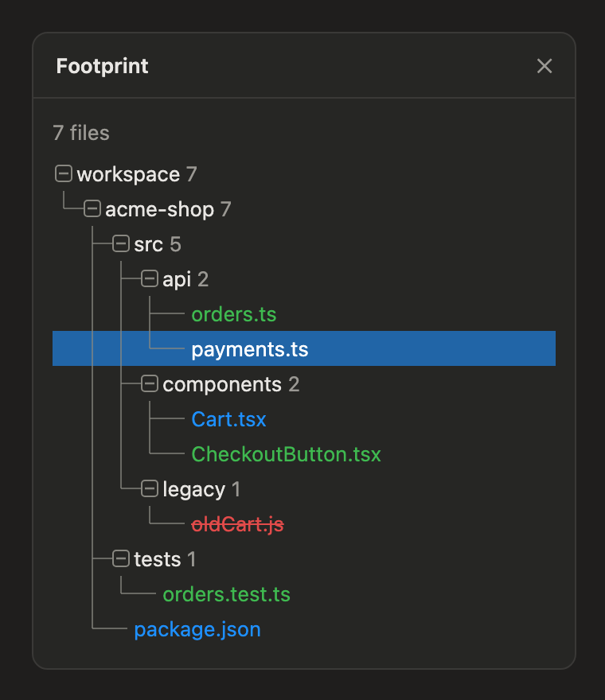

# Footprint

Footprint is a mod for Claude Code. It adds a pane that shows the tree of files the current session created, modified or deleted. The pane shows only those files, not the whole tree.



*Demo data: the pane's real render output for a sample project, `/workspace/acme-shop`.*

## Install

Type this at the prompt of a Claude Code session:

```
/plugin install footprint --marketplace bilgili/footprint
```

Answer `y` to add the marketplace, then pick a scope. The pane opens with the next session on the desktop app. In the terminal, or after a close, type `/footprint`.

## What it shows

One tree from the filesystem root, one folder row per path segment, every folder collapsed until you press it. Drawn guide lines and a boxed `+`/`-` before each folder on the desktop app, VS Code and mobile; plain indent in the terminal.

File names are colored by status: green for added, blue for modified, red and struck through for deleted. Long names are cut in the middle. A file the session created and then removed is hidden. When a file changes, the row that shows it flashes in its color and fades within 3 seconds: the file itself when it is visible, else its first collapsed parent folder. A press on an added or modified file opens it in the desktop app's file pane.

## How it works

The mod keeps a ledger in session state. Two sources feed it:

- **Tool source.** `Write`, `Edit` and `NotebookEdit` calls. The mod looks at the file before and after the call.
- **Bash source.** The mod walks the session root before and after each foreground Bash call and records the difference. It skips `.git`, `node_modules`, `build`, `dist`, `.venv` and similar folders. A tree over 20000 files turns Bash tracking off for that folder; a walk over 5 seconds skips that one call. The pane header says so.

The ledger stores two looks per path: the earliest (the baseline) and the latest. The status comes from those two looks. The merge is order-free, so concurrent calls give one answer.

## Limits

- A change seen during a Bash call is counted whoever made it: an editor that saves in that window counts too.
- Background Bash calls are not tracked.
- A same-size rewrite inside the file system's mtime resolution is missed.
- `/clear` and `--resume` start an empty ledger.
- The pane works on the desktop app and in the terminal; the press-to-open needs the desktop app.

## Develop

```
claude plugin validate .
claude plugin test .
```

## License

MIT
