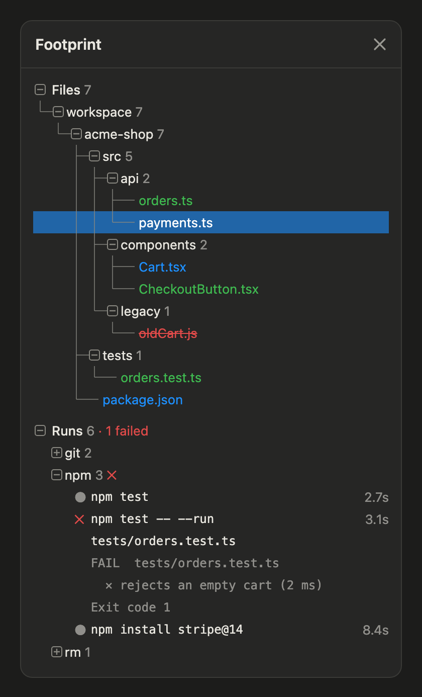

# Footprint

Footprint is a mod for Claude Code. It adds a pane with two sections. The Files section shows the tree of files the current session created, modified or deleted. It shows only those files, not the whole tree. The Runs section lists the commands that the session executed, grouped by program.



*Demo data: the pane's real render output for a sample project, `/workspace/acme-shop`. The Runs section shows the `npm` group open, with one failed run and its output.*

## Install

Footprint is a Claude Code plugin. Its GitHub repository, `bilgili/footprint`, is also its plugin marketplace. Footprint runs in the Claude Code desktop app and in the terminal. Opening a file from the pane works only in the desktop app.

### From a Claude Code session

Type this at the prompt:

```
/plugin install footprint --marketplace bilgili/footprint
```

1. Answer `y` to add the `footprint` marketplace.
2. Pick a scope. See [Scope](#scope).
3. Restart Claude Code. A plugin loads when a session starts.

### From a shell

```bash
claude plugin install footprint --marketplace bilgili/footprint
```

This command adds the marketplace when it is missing, and installs Footprint for your user. To do the two steps one at a time:

```bash
claude plugin marketplace add bilgili/footprint
```

```bash
claude plugin install footprint@footprint
```

Restart Claude Code after the install.

### Scope

| Scope | Flag | Footprint is enabled for |
|---|---|---|
| user (default) | `-s user` | you, in every project on this machine |
| project | `-s project` | everyone who uses the shared settings of this project |
| local | `-s local` | you, in this project only |

Add the flag to the install command, for example `claude plugin install footprint@footprint -s project`.

### Check the install

```bash
claude plugin list
```

The list shows `footprint@footprint`, its version and `Status: ✔ enabled`.

Start a session. In the desktop app, the Footprint pane opens by itself. In the terminal, type `/footprint` to open it. To open the pane again after you close it, type `/footprint`.

### Update

First refresh the marketplace catalog, then update the plugin:

```bash
claude plugin marketplace update footprint
```

```bash
claude plugin update footprint@footprint
```

Restart Claude Code to load the new version. Claude Code compares version numbers. If it reports the latest version, no newer release exists.

### Disable or remove

To turn Footprint off but keep it installed:

```bash
claude plugin disable footprint@footprint
```

To turn it on again, use `claude plugin enable footprint@footprint`.

To remove Footprint:

```bash
claude plugin uninstall footprint@footprint
```

If you installed Footprint with `-s project` or `-s local`, add the same flag, for example `claude plugin uninstall footprint@footprint -s project`.

To remove the marketplace too:

```bash
claude plugin marketplace remove footprint
```

### Troubleshooting

- The pane does not open: type `/footprint`. In the terminal, the pane does not open by itself.
- After an update, the pane does not change: restart Claude Code, then type `/footprint`.
- `/footprint` is not a known command: run `claude plugin list`. If Footprint is not in the list, install it. If its status is not enabled, enable it. Then restart Claude Code.

## What it shows

One tree from the filesystem root, one folder row per path segment, every folder collapsed until you press it. Drawn guide lines and a boxed `+`/`-` before each folder on the desktop app, VS Code and mobile; `│ ├─ └─` guide characters and a `+`/`-` in the terminal.

File names are colored by status: green for added, blue for modified, red and struck through for deleted. Long names are cut in the middle. A file the session created and then removed is hidden. When a file changes, the row that shows it flashes in its color and fades within 3 seconds: the file itself when it is visible, else its first collapsed parent folder. A press on an added or modified file opens it in the desktop app's file pane. For a file outside the working directory, the app first asks you to grant the file's folder to the session. After you approve, the folder stays granted for the session.

### Runs

Each section has a header row with a `+` or `-` (boxed on the desktop). A press on the header opens or closes the section. Files starts open. Runs starts closed and does not draw until the session runs a command. The Runs header shows the count of runs and, when a run failed, the count of failed runs.

An open Runs section shows one row for each program: `git`, `npm`, `rm` and so on. The mod takes the program from the first word of the command, after any `cd x &&`, `NAME=value` words and wrappers such as `sudo` and `env`. A group row shows the count and a mark for its worst status. A press on a group row opens it.

An open group shows one entry for each execution, newest first. An entry shows a status mark, the whole stored command line and the duration. A long command wraps, and its line breaks stay. The marks are `●` ok, `✕` failed, `◌` background and `■` interrupted. A press on the mark of an entry that has output shows or hides the last 1000 characters of that output. For a failed command, the output holds the exit code line. A background command and a `Monitor` have no output to show. The mark and the duration sit on the first line of a command that wraps.

When a command ends, the row that shows it flashes and fades within 3 seconds, as a changed file does (a background command flashes when it starts, because its end is never seen): the entry when its group is open, else the group row, else the Runs header. The flash is green for ok, red for failed and amber for background and interrupted. Where a flash is at full strength, its status-colored text turns white for a moment.

## How it works

The mod keeps a ledger in session state. Two sources feed it:

- **Tool source.** `Write`, `Edit` and `NotebookEdit` calls. The mod looks at the file before and after the call.
- **Bash source.** The mod walks the session root before and after each foreground Bash call and records the difference. It skips `.git`, `node_modules`, `build`, `dist`, `.venv` and similar folders. A tree over 20000 files turns Bash tracking off for that folder; a walk over 5 seconds skips that one call. The pane header says so.

The ledger stores two looks per path: the earliest (the baseline) and the latest. The status comes from those two looks. The merge is order-free, so concurrent calls give one answer.

A separate log feeds the Runs section. A hook wraps each `Bash` call and each `Monitor` call that has a command. It records the command, the start time, the duration, the status and the output tail. The log keeps the newest 100 runs. The state of the sections and groups lives in its own atom, apart from the state of the folders.

## Limits

- A change seen during a Bash call is counted whoever made it: an editor that saves in that window counts too.
- Background Bash calls are not tracked.
- A same-size rewrite inside the file system's mtime resolution is missed.
- `/clear` and `--resume` start an empty ledger.
- The pane works on the desktop app and in the terminal. Opening a file from the pane works only in the desktop app.
- The duration of a run is the wall time of the call. It includes the time that you spend on a permission prompt.
- The tool result has no exit code. A run shows `failed` when the call reports an error, and its output shows the exit code line.
- A background command and a `Monitor` stay `background`. The log gets no later update and no output for them.
- A command that you reject at the permission prompt, or that a permission rule or a setting denies, shows as `failed`: Claude Code reports it as an error. Only a deny from another mod's hook leaves no run.
- The log removes escape sequences and control characters from the command and the output. A progress bar that rewrites one line shows as one line of joined text.
- A command that a subagent runs has a run too.
- A command keeps its first 2000 characters. The program name comes from a word scan, not a shell parser: `bash -c "git push"` groups as `bash`, and `xargs git` groups as `xargs`.
- A mod reload during a command loses that run.

## Develop

Check the manifest and run the tests from a clone:

```bash
claude plugin validate .
```

```bash
claude plugin test .
```

To try a clone in Claude Code, use the clone as the marketplace. The GitHub marketplace and the clone have the same name, `footprint`, so remove the GitHub marketplace first. This removes it from all your scopes. When you finish, install from GitHub again:

```bash
claude plugin marketplace remove footprint
```

```bash
claude plugin marketplace add /path/to/your/footprint/clone
```

```bash
claude plugin install footprint@footprint
```

Claude Code runs a copy of the plugin from its cache, one folder for each version. An edit in the clone does not reach that copy. To load an edit, raise `version` in `.claude-plugin/plugin.json`, then run:

```bash
claude plugin marketplace update footprint
```

```bash
claude plugin update footprint@footprint
```

Then restart Claude Code. For most work, `claude plugin test .` is faster: it runs the hooks module from the clone, with no install.

## License

MIT
